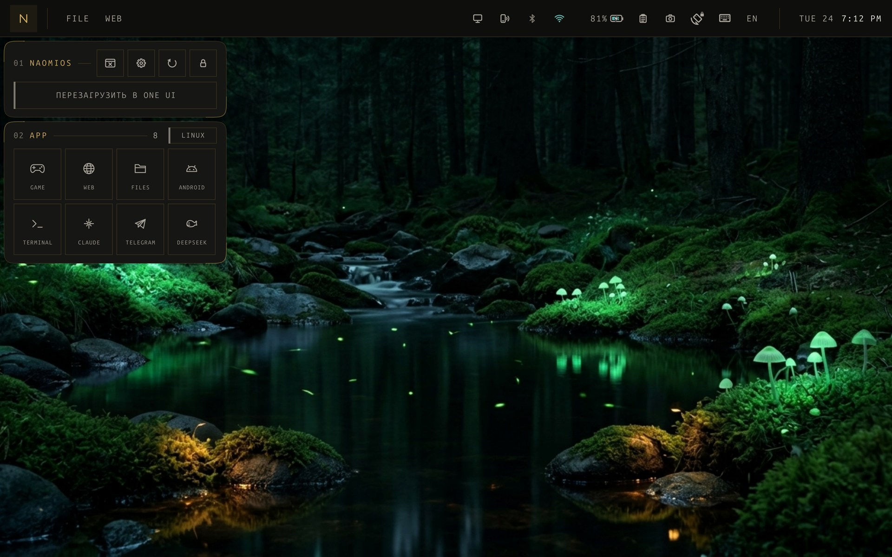
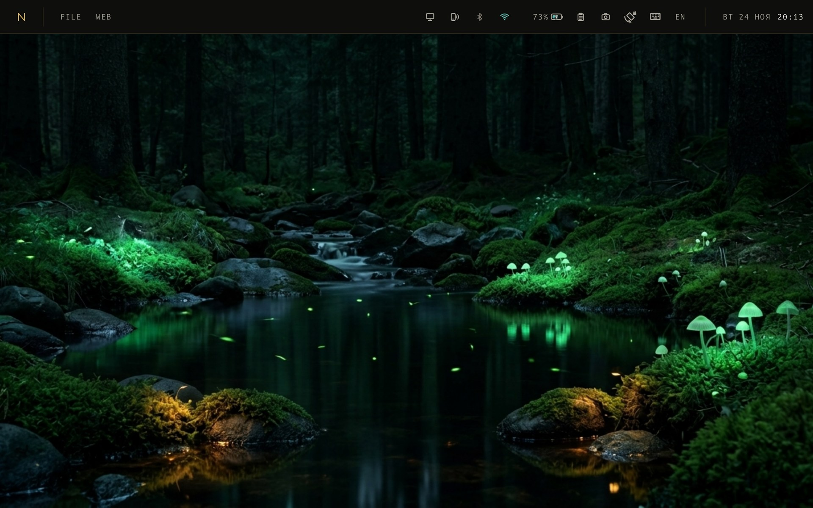
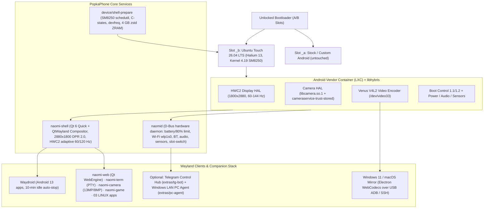

# PopkaPhone for Xiaomi Pad 6 (`pipa`)

**English** · [Русский](README.ru.md)

[](https://github.com/nIzE-666/PopkaPhone-pipa/actions/workflows/ci.yml)
[](https://github.com/nIzE-666/PopkaPhone-pipa/releases)
[](LICENSE)
[-blue)](docs/PIPA.md)
[](docs/PIPA-INSTALL.en.md)

**A native Qt 6 / Wayland desktop Linux shell, hardware daemon, dual-camera stack, and companion ecosystem for the Xiaomi Pad 6 (`pipa`, Qualcomm Snapdragon 870 / `SM8250`) — dual-booting Ubuntu Touch 26.04 LTS (Halium 13) on slot `_b` without wiping Android on slot `_a`.**

> Derived from [PopaSpinka/PopkaPhone](https://github.com/PopaSpinka/PopkaPhone) (originally built for Google Pixel 5 / `redfin`, MIT) and expanded by **+20,811 / −1,063 lines across 181 files** to deliver a complete, daily-usable 11″ Linux tablet desktop on `SM8250`.



<sub>Captured live on a Xiaomi Pad 6 (`pipa`) running PopkaPhone on Ubuntu Touch 26.04 (Halium 13) at native 2880×1800 resolution: top bar, `01 NAOMIOS` system controls + one-tap Android slot switch, `02 APP`, and the `LINUX` desktop app launcher.</sub>

---

## Why This Project Exists & Community Value

Mainline Linux on modern Qualcomm tablets (`SM8250` / `kona`) still lacks reliable camera, hardware video encoding, high-refresh display composition, and power-management support for everyday use. Meanwhile, Halium-based mobile Linux images provide vendor kernel and Android HAL access, but ship with phone-oriented shells not designed for 11″ 2880×1800 multi-window desktop workflows.

**`PopkaPhone-pipa` bridges that gap as an open MIT reference implementation:**
- **Reusable `SM8250` / Halium 13 hardware integration:** direct `libhybris` HWC2 linear `CLIENT`-target rendering (`1800×2880` panel rotated cleanly in scene space), dynamic `60/90/120/144 Hz` mode enumeration, `msm_vidc` / Venus V4L2 (`/dev/video33`) H.264/HEVC encoding, and `4-0011` sysfs backlight + `night_charging` 80% charge limiting.
- **Standalone `libhybris` dual-camera architecture without Lomiri:** `shell/apps/camera/` (`naomi-camera`) demonstrates how a Qt 6 Wayland SHM app can drive Android Camera HAL (`libcamera.so.1`) via an offscreen null-platform EGL Pbuffer (`HYBRIS_EGLPLATFORM=null`) alongside `cameraservice-trust-stored`, supporting both back (13 MP) and front (8 MP) sensors, zoom, tap-to-focus, torch, and `ffmpeg` H.264 video recording.
- **Non-destructive A/B dual-boot workflow:** runs Ubuntu Touch in an ext4 container on `/data` using slot `_b` while leaving Android intact on slot `_a`, with verified Boot Control 1.1/1.2 switching from both Linux (`naomi-pipa-slot-switch`) and Android (`tablet/boot-switch`).
- **Tablet-scale Wayland shell & reproducible on-device builds:** `tools/pipa.py` + `device/devroot.sh` validate device identity and slot safety before staging or building natively on the tablet's Snapdragon 870.

---

## What Changed vs. Upstream `PopaSpinka/PopkaPhone`

Upstream `PopkaPhone` (commit `25c1d6b`) targeted Google Pixel 5 (`redfin`, Snapdragon 765G, 90 Hz OLED, Ubuntu Touch 24.04) with a phone home screen and external Raspberry Pi / macOS desktop streaming. `PopkaPhone-pipa` transforms it into a self-contained tablet desktop platform:

| Subsystem | Upstream `PopkaPhone` (Pixel 5) | `PopkaPhone-pipa` (Xiaomi Pad 6) |
|---|---|---|
| **Target hardware & OS** | Google Pixel 5 (`redfin`, SM7250), Ubuntu Touch 24.04, full wipe | Xiaomi Pad 6 (`pipa`, SM8250), Ubuntu Touch 26.04 LTS (Halium 13), non-destructive A/B dual-boot on `_b` |
| **Display & compositor** | Phone portrait shell + external 1280×720 desktop output, 60/90 Hz OLED | Native on-screen 11″ `2880×1800` (`1440×900 dp` at DPR 2.0) Wayland desktop, `60/90/120/144 Hz` HWC2 (adaptive `60↔120 Hz`), 4-way rotation + auto-rotate lock |
| **Tablet multitasking & UX** | Mouse/dock-centric desktop | 50/50 Split-Screen snapping, Always-on-Top PiP pinning, Clipboard History popover (`06 БУФЕР`) + PC sync, quick screenshot, `03 LINUX` `.desktop` launcher, Laptop auto-mode (USB/BT keyboard & DP-Alt detection) |
| **Native Camera** | Not implemented | New C++/QML `naomi-camera` (`shell/apps/camera/`): back 13 MP + front 8 MP via `libhybris` `libcamera.so.1`, zoom, tap-to-focus, flash/torch, MP4 recording (`ffmpeg`), headless `--snap`/`--torch` CLI |
| **Pro Settings** | Basic phone/desktop toggles | 24-hour/12-hour clock, seconds, warm Night Filter overlay (`0–60%`), terminal & clipboard preferences (`InterfacePage`), live SM8250 CPU governor/thermals/ZRAM/service toggles (`SystemPage`), Mouse & VPN pages |
| **SM8250 power & tuning** | Pixel SM7250 `policy0/6/7`, Google charger nodes | `schedutil` + input boost, unlocked C-states, L3/LLCC/DDR/NPU devfreq, 4 GB `zstd` ZRAM, `read_ahead_kb=128`, PulseAudio 48 kHz, hardware 80% charge limit (`night_charging`) |
| **Windows 11 Mirror** | macOS Electron viewer only | Cross-platform Windows 11 Electron client (`mirror/`, `tools/mirror_win.py`) over USB (`adb forward`) & Wi-Fi (`ssh -W`) with WebCodecs H.264/HEVC Annex B |
| **Companion ecosystem** | None | Optional self-hosted Telegram Control Hub (`extras/tg-bot/`, 21 commands, `/mode`, `/term`, `/cam`, `/clip`, LAN DLNA server) & zero-dependency Windows LAN PC Agent (`extras/pc-agent/pc_agent.py`) |
| **Travel security & VPN** | None | Home/Away/Auto `iptables`/`ip6tables` firewall (`device/pipa-mode`), NM SSID auto-switch + MAC scan randomization, and DNS-leak-free TUN VPN (`device/pipa-vpn`, DoH + NTP bypass) |
| **Automated tests** | Manual device benchmarks | **99 Python unit tests** (`tools/tests/`) + **8 Node mirror tests** (`mirror/tests/`) running automatically in GitHub Actions CI |



<sub>Clean desktop view captured on Xiaomi Pad 6 (`pipa`) showing the 24-hour status bar (`FILE`, `WEB`, display, audio, Bluetooth, Wi-Fi, battery, clipboard history, quick screenshot, rotation lock, on-screen keyboard, layout indicator, and clock).</sub>

---

## System Architecture



---

## Hardware Support Matrix (Xiaomi Pad 6 `pipa`)

Measured on Ubuntu Touch 26.04 LTS (`utnext/arm64/android9plus/daily`), Halium 13 (`thespider2/ubuntu-touch-xiaomi-pipa` v0.2.0, kernel 4.19 `aymanrgab/linux-android-xiaomi-pipa`), vendor Android 13:

| Component | Status | Notes |
|---|---|---|
| 11″ IPS Display (`2880×1800`) | Working | Native HWC2 `CLIENT` target, `60/90/120/144 Hz` (adaptive `60↔120 Hz`), sysfs backlight `4-0011` |
| Touchscreen & Rotation | Working | Multi-touch, terminal touch gestures, `sensorfwd` auto-rotate + long-press rotation lock |
| GPU Adreno 650 (EGL/GLES3) | Working | Hardware-accelerated `naomi-shell`, `naomi-web`, and video playback |
| CPU Snapdragon 870 (`SM8250`) | Working | `schedutil`, C-states, L3/LLCC/DDR/NPU devfreq, 4 GB `zstd` ZRAM, `~39–40 °C` idle |
| Quad Speakers (Aqstic WCD938x) | Working | PulseAudio Droid HAL at 48 kHz (`avoid-resampling=yes`) |
| Wi-Fi (`wlp1s0`) & Bluetooth | Working | NetworkManager `wlp1s0`, BlueZ keyboards, mice, audio, and gamepads |
| Rear 13 MP & Front 8 MP Cameras | Working | `naomi-camera` via `libhybris` `libcamera.so.1` + `cameraservice-trust-stored`; JPEG capture, zoom, autofocus, flash/torch, MP4 recording (`ffmpeg`) |
| Battery & 80% Charge Limit | Working | Live telemetry via `naomid` + hardware `night_charging` 80% cap in Settings → Battery |
| A/B Dual-Boot (`_a` ↔ `_b`) | Working | Non-destructive switch via `N` menu (`naomi-pipa-slot-switch`) and Android app/QS tile (`tablet/boot-switch`) |
| Waydroid (Android 13) | Working | Runs windowed inside `naomi-shell` with 10-minute idle auto-stop |
| USB-C DP-Alt External Display | Partial | `card0-DP-1` connection detection and laptop auto-mode implemented; full multi-head DRM output is on the roadmap |
| Hardware Video Streaming (Venus) | Working | `/dev/video33` H.264/HEVC encoder → Windows 11 Mirror over USB ADB or SSH tunnel |

---

## Quick Start & Recovery

Read the complete step-by-step guide (including mandatory slot `_a` backup, Ubuntu Touch `_b` base setup, `devroot` native build, camera activation, optional companion tools, and fastboot recovery):

- **English:** **[docs/PIPA-INSTALL.en.md](docs/PIPA-INSTALL.en.md)**
- **Русский:** **[docs/PIPA-INSTALL.md](docs/PIPA-INSTALL.md)**
- **Hardware & Architecture Audit (`SM8250` / HWC2 / Venus):** **[docs/PIPA.md](docs/PIPA.md)**
- **Windows 11 Mirror Client Guide:** **[docs/WINDOWS-MIRROR.md](docs/WINDOWS-MIRROR.md)**

Summary of the build & install flow once Ubuntu Touch 26.04 is running on slot `_b` with SSH access:

```sh
# 1. Verify device model (pipa), OS (Ubuntu Touch 26.04 arm64), and active slot (_b)
python3 tools/pipa.py check --ssh <TABLET_IP>

# 2. Stage source tarball and build natively on the Snapdragon 870 (~2-3 min)
python3 tools/pipa.py stage --ssh <TABLET_IP>
# (First time only on tablet: sudo sh ~/naomi/src/pipa-<SHA>/device/devroot.sh create && ... packages)
python3 tools/pipa.py build --ssh <TABLET_IP> --jobs 4
```

Then on the tablet:

```sh
ln -sfn /home/phablet/naomi/build-pipa-<SHA> /home/phablet/naomi/build
sudo sh /home/phablet/naomi/src/pipa-<SHA>/device/install-shell.sh install
sudo systemctl mask lightdm.service
sudo systemctl enable --now naomid.service naomi-shell.service
```

**Emergency rollback to Android (slot `_a`):**

```sh
fastboot set_active a
fastboot reboot
```

---

## Testing & Continuous Integration

Host-side Python unit tests, C++ unit harnesses (for display geometry, keyboard logic, WebAuth UA filtering, and stream framing), and Electron Mirror tests run automatically in **[GitHub Actions CI](.github/workflows/ci.yml)** on both Linux and Windows:

```sh
# Install optional bot test dependencies (required for extras/tg-bot test suite)
python3 -m pip install -r extras/tg-bot/requirements.txt

# Run all 99 Python & C++ harness unit tests
python3 -m unittest discover -s tools/tests -v

# Run all 8 Windows/macOS Mirror tests (Node.js 20+)
node --test mirror/tests/keyboard.test.js mirror/tests/stream.test.js
```

> Full Qt 6 / `libhybris` / HWC2 binary compilation targets `arm64` Ubuntu Touch `devroot` on the device because it links against Halium vendor headers and UBports Qt 6.10.2 private APIs.

---

## Repository Layout

| Path | Description |
|---|---|
| `shell/` | Qt 6 / C++ / QML desktop shell (`app/`), HWC2 display backend (`display/`), hardware daemon (`naomid/`), browser (`apps/web/`), terminal (`term/`), **native dual-camera app (`apps/camera/`)**, libretro launcher (`apps/game/`), keyboard (`input/`), Venus stream (`stream/`), device profile (`device_profile.cpp`) |
| `device/` | On-device scripts & configs: `shell-prepare` (SM8250 & 4 GB ZRAM), `install-shell.sh`, `devroot.sh`, `pipa-mode` + `pipa-firewall.service` + `95-pipa-mode` + `zz-pipa-security.conf` (Home/Away/Auto firewall & MAC randomization), `pipa-vpn` (DNS-leak-free TUN VPN), `91-pipa-audio-jack.rules`, `naomi-camera`, `naomi-pipa-slot-switch`, `naomi-telegram`, `naomi-deepseek` |
| `tablet/boot-switch/` | Minimal Android app & Quick Settings tile to reboot safely from Android (`_a`) into Ubuntu Touch (`_b`) |
| `mirror/` | Electron Mirror client for Windows 11 & macOS (`build-win.ps1`, WebCodecs H.264/HEVC, `mirror/tests/`) |
| `extras/tg-bot/` | Optional self-hosted Telegram Control Hub (`aiogram 3`, 21 commands, `/mode`, `/term`, `/cam`, `/clip`, LAN DLNA server) |
| `extras/pc-agent/` | Optional zero-dependency Windows LAN PC companion agent (`pc_agent.py`, RFC1918 guard + token auth) |
| `tools/` | Host CLI tools (`pipa.py`, `mirror_win.py`) and 99 automated unit tests (`tools/tests/`) |
| `docs/` | Installation guides (`PIPA-INSTALL.en.md`, `PIPA-INSTALL.md`), deep SM8250 audit (`PIPA.md`), Windows Mirror guide, and upstream technical notes |

---

## Roadmap & Contributing

- See **[ROADMAP.md](ROADMAP.md)** for upcoming milestones (audio-in-video camera muxing, mainline/USB-C external display output, automated `arm64` build packaging, and generalization to other `SM8250` tablets).
- See **[CHANGELOG.md](CHANGELOG.md)** for release history.
- See **[CONTRIBUTING.md](CONTRIBUTING.md)** for development workflow, testing requirements, privacy rules, and PR guidelines.

---

## License & Attribution

- Project code is licensed under the **[MIT License](LICENSE)** (`Copyright (c) 2026 Popka` and `Copyright (c) 2026 nIzE-666`).
- Upstream foundation: **[PopaSpinka/PopkaPhone](https://github.com/PopaSpinka/PopkaPhone)** (MIT).
- Ubuntu Touch base port for Xiaomi Pad 6: **[thespider2/ubuntu-touch-xiaomi-pipa](https://github.com/thespider2/ubuntu-touch-xiaomi-pipa)** and kernel **[aymanrgab/linux-android-xiaomi-pipa](https://github.com/aymanrgab/linux-android-xiaomi-pipa)**.
- Full third-party notices and component licenses: **[THIRD-PARTY.md](THIRD-PARTY.md)**. No proprietary firmware images, ROMs, fonts, or personal credentials are stored in this repository.
