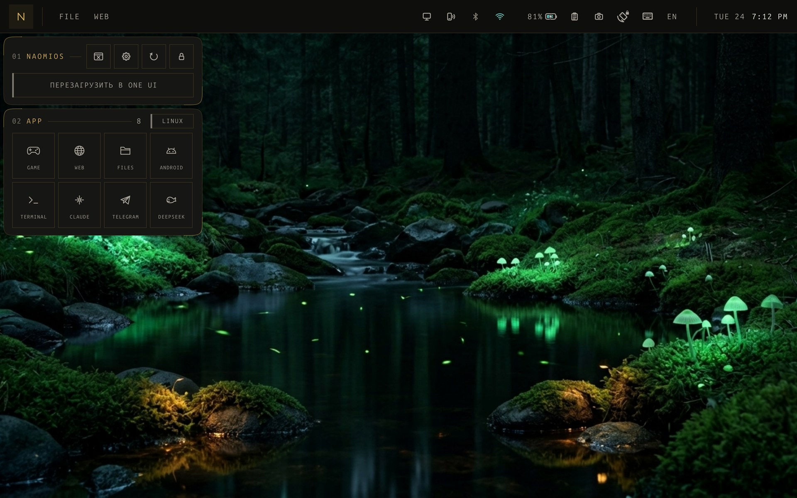

# PopkaPhone для Xiaomi Pad 6 (`pipa`)

[English](README.md) · **Русский**

[](https://github.com/nIzE-666/PopkaPhone-pipa/actions/workflows/ci.yml)
[](https://github.com/nIzE-666/PopkaPhone-pipa/releases)
[](LICENSE)

**Полноценный настольный Linux (Ubuntu Touch 26.04 LTS / Halium 13 + оболочка PopkaPhone на Qt 6 / Wayland) для планшета Xiaomi Pad 6 (`pipa`, Snapdragon 870 / `SM8250`) с dual-boot на слоте `_b` без удаления Android на слоте `_a`.**

> Форк и глубокий планшетный порт оригинального проекта [PopaSpinka/PopkaPhone](https://github.com/PopaSpinka/PopkaPhone) (MIT, исходно для Pixel 5) — **+20 811 / −1 063 строк в 181 файле**: 11″ экран 2880×1800 60–144 Гц, тюнинг `SM8250`, нативное приложение обеих камер, продвинутые Настройки, клиент зеркалирования для Windows 11 и опциональный Telegram-центр управления.



<sub>Живой снимок экрана Xiaomi Pad 6 (`pipa`) в нативном разрешении 2880×1800: верхняя панель, меню `01 NAOMIOS` с кнопкой переключения слота в Android, `02 APP` и кнопка `LINUX` для установленных Linux-программ.</sub>

---

## Возможности

### 1. Система, ядро SM8250 и автономность (`device/shell-prepare`, `shell/naomid/`)
- **Dual-boot без потери Android:** Ubuntu Touch 26.04 LTS (Halium 13) работает на слоте `_b` (ext4-контейнер на `/data`), Android остаётся нетронутым на слоте `_a`. Переключение систем в 1 тап — из меню `N` («Перезагрузить в One UI») и через Android-приложение/плитку `PopkaPhone-Boot-Switch` (`tablet/boot-switch/`).
- **Тюнинг Snapdragon 870 (`SM8250`) и автономность (`v0.3.0-pipa`):** настроенный `ondemand` с автообнаружением кластеров (`300 / 710 / 845 МГц` в простое вместо залипания `schedutil` на 100% MAX), UFS 3.1 `auto_hibern8` + `clkgate`, GPU `force_no_nap=0` (150 МГц в простое), штатные лимиты шин `bw_hwmon`, остановка 10 лишних LXC-демонов и `nfcd`/`ofono`, мягкая термозащита корпуса `quiet_therm` (`39 / 42 / 45 °C`) и профили `Эконом (60 Гц) / Баланс (120→30 Гц) / Максимум (144 Гц)`.
- **Память, звук и хранилище:** 4 ГБ ZRAM (`zstd`, `page-cluster=0`, `swappiness=80`), `read_ahead_kb=128`, PulseAudio 48 kHz (`avoid-resampling=yes`), отключены скрытые «запасные» рендереры (`NAOMI_WEB_NO_SPARE=1`).
- **Адаптивный дисплей и настоящий сон:** `120 → 30 Гц` в простое (таймер 2,2 с), аппаратное сжатие буферов UBWC (`NAOMI_PIPA_UBWC`), аппаратная матрица ночного фильтра HWC2 CTM, реальное отключение дисплея `HWC2_POWER_MODE_OFF` (`mdss_mdp` уходит в `suspended`), исправленная заморозка приложений `cgroup.freeze` при гашении экрана, динамический `wake_lock` и опциональный глубокий сон (`deep`/`mem`) в Настройках.
- **Защита батареи:** аппаратное ограничение заряда на 80% (`night_charging`).
- **Режим безопасности «Дома / Вне дома / Авто» и VPN без утечки DNS (`device/pipa-mode`, `device/pipa-vpn`):** фаервол `iptables`/`ip6tables` (`PIPA_IN`/`PIPA_IN6`) до старта сети, автоопределение `wlan*`/`wlp*` и автопереключение по SSID (`95-pipa-mode`), рандомизация MAC при сканировании Wi-Fi (`zz-pipa-security.conf`), системный TUN VPN с DoH (`127.0.0.1:1053`) и обходом для NTP (UDP/123).

### 2. Нативный рабочий стол 11″ (`shell/`)
- **Композитор Wayland на 2880×1800 (`DPR 2.0`, 1440×900 dp)** с приоритетом `Nice=-5`.
- **Многозадачность:** Split-Screen 50/50, Always-on-Top / PiP (закрепление окна поверх остальных), история буфера обмена (`06 БУФЕР`, 15 записей + синхронизация с Windows ПК), быстрый скриншот, блокировка автоповорота долгим нажатием, авто-режим «Ноутбук» (при подключении USB/BT-клавиатуры и детекте `card0-DP-1`).
- **Прокачанный терминал (`naomi-term`):** сенсорная панель спецклавиш с виброоткликом, жесты прокрутки и масштабирования шрифта, автопроброс `WAYLAND_DISPLAY=wayland-naomi`, кнопка «Открыть в Терминале» в «Файлах».
- **Приложения:** раздел `03 LINUX` с поиском по `.desktop`, браузер `naomi-web` (Qt WebEngine с тёмной/светлой темой и фильтрами), Waydroid (Android 13 с автоостановкой через 10 мин простоя), `wlfreerdp` и Parsec Web.
- **Продвинутые Настройки:** 24-часовой и 12-часовой формат часов, секунды, тёплый ночной фильтр (`0–60%`), профиль CPU (`Эконом / Баланс / Максимум`), живые температуры, ZRAM, тумблеры служб, часовой пояс, NTP, очистка логов, разделы «Мышь» и «VPN».


### 3. Нативное приложение «Камера» (`shell/apps/camera/` → `naomi-camera`)
- Прямая работа с Android Camera HAL на Halium 13 через `libhybris` (`libcamera.so.1`) и `cameraservice-trust-stored` с внеэкранным EGL Pbuffer (`HYBRIS_EGLPLATFORM=null`):
  - **Задняя 13 МП (`4208×3120`)** — фото, зум, автофокус по тапу, вспышка (`Выкл / Авто / Вкл / Фонарик`).
  - **Фронтальная 8 МП (`3264×2448`)** — фото, зеркалирование, зум.
- **Запись видео MP4 (H.264)** через `ffmpeg`, таймер 3 с / 10 с, выбор разрешения, CLI-режим `--snap back|front` и `--torch`.

### 4. Windows 11 Mirror и экосистема (`mirror/`, `extras/`)
- **Клиент зеркалирования для Windows 11 (`mirror/`, `tools/mirror_win.py`):** Electron-клиент по USB (`adb forward`) и Wi-Fi (`ssh -W`), WebCodecs H.264/HEVC (Annex B), передача мыши, клавиатуры и буфера обмена ([docs/WINDOWS-MIRROR.md](docs/WINDOWS-MIRROR.md)).
- **Telegram-бот центр управления (`extras/tg-bot/`):** опциональный self-hosted бот (`aiogram 3`, 21 команда, защита по `OWNER_ID` через `/pair`, `/mode`, `/term`, `/cam`, `/clip`, локальный DLNA-сервер для ТВ, управление ПК).
- **Windows ПК-агент (`extras/pc-agent/pc_agent.py`):** лёгкий локальный HTTP-агент без сторонних зависимостей (только подсети RFC1918 + заголовок `X-Pipa-Token`).

---

## Установка и восстановление

- **Пошаговая инструкция на русском:** **[docs/PIPA-INSTALL.md](docs/PIPA-INSTALL.md)**
- **English Installation Guide:** **[docs/PIPA-INSTALL.en.md](docs/PIPA-INSTALL.en.md)**
- **Технический разбор железа `pipa`:** **[docs/PIPA.md](docs/PIPA.md)**
- **Windows 11 Mirror:** **[docs/WINDOWS-MIRROR.md](docs/WINDOWS-MIRROR.md)**

---

## Тесты и CI

В **[GitHub Actions](.github/workflows/ci.yml)** автоматически прогоняются **102 Python/C++ unit-теста** (`tools/tests/`) и **8 Node-тестов Mirror** (`mirror/tests/`) на Linux и Windows:

```sh
python3 -m pip install -r extras/tg-bot/requirements.txt
python3 -m unittest discover -s tools/tests -v
node --test mirror/tests/keyboard.test.js mirror/tests/stream.test.js
```

---

## Дорожная карта, вклад и лицензия

- **[ROADMAP.md](ROADMAP.md)** — дальнейшее развитие порта.
- **[CHANGELOG.md](CHANGELOG.md)** — история релизов.
- **[CONTRIBUTING.md](CONTRIBUTING.md)** — как участвовать в разработке.
- Лицензия — **[MIT](LICENSE)** (основа — [PopaSpinka/PopkaPhone](https://github.com/PopaSpinka/PopkaPhone), порт Ubuntu Touch — [thespider2/ubuntu-touch-xiaomi-pipa](https://github.com/thespider2/ubuntu-touch-xiaomi-pipa)). Сторонние компоненты перечислены в **[THIRD-PARTY.md](THIRD-PARTY.md)**.
